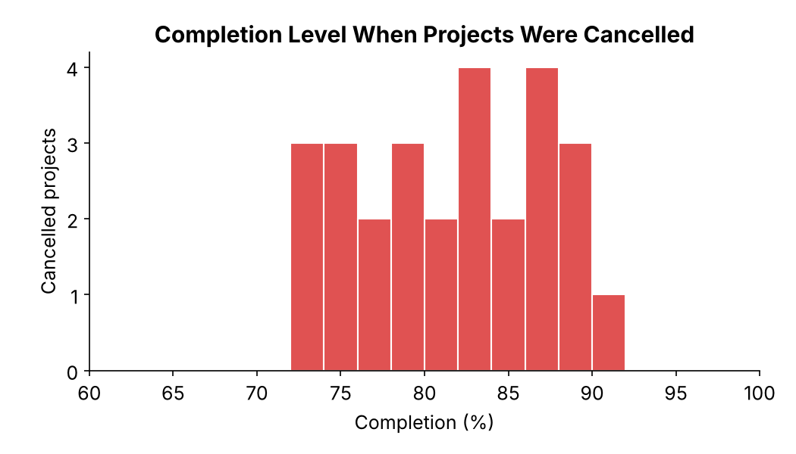
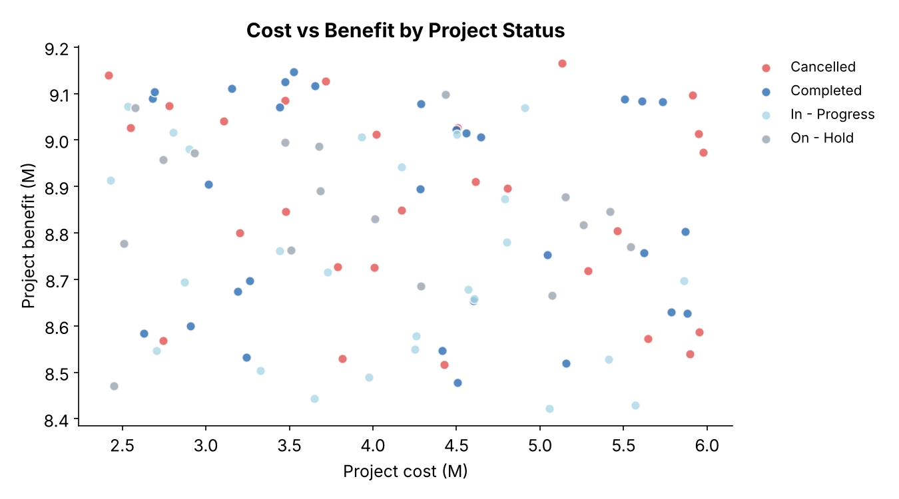
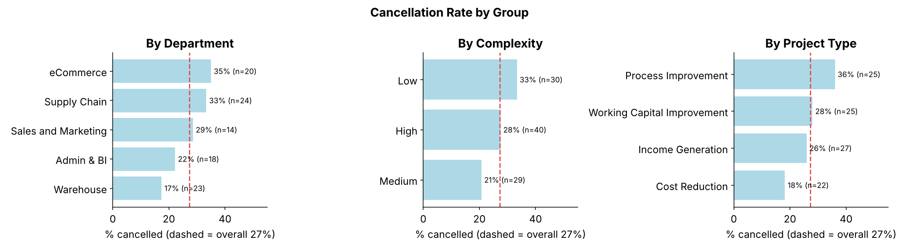

# Project Portfolio Analysis: Why Are 27% of Projects Cancelled?

Analysis of a 99-project portfolio (2021–2025) to find where and when projects fail and whether the approval criteria predict success. It ends with governance recommendations for a PMO.

**Tools:** Python (pandas, SciPy, Matplotlib)
**Methods:** chi-square tests, Kruskal-Wallis tests, portfolio and phase analysis

📓 [Notebook](notebooks/project_portfolio_analysis.ipynb)

---

## Business questions
1. Are cancellations concentrated in particular departments, complexity levels, project types or managers?
2. Does the business case (cost, benefit, ROI) predict which projects get delivered?
3. When in the lifecycle are projects cancelled, and what does that cost?

## Key results

| Finding | Evidence |
|---|---|
| **27% of projects cancelled** | 27 cancelled, 30 completed, 25 in progress, 17 on hold |
| **Cancellations happen late** | Cancelled projects were **72–90% complete** (median 82%) when stopped |
| **High cost of late cancellation** | Cancelled projects hold **28% of portfolio cost** and **27% of planned benefit** |
| **Business case doesn't predict outcome** | Cost and ROI are the same across statuses (Kruskal-Wallis p = 0.59, 0.68) |
| **No single group to blame** | Cancellation rates of 17–36% by department, complexity or type. None significant (χ² p ≥ 0.17) |

<p align="center">
  
  
</p>
<p align="center">
  
</p>

## Recommendations
1. **Stage-gate reviews.** Hold a formal go/no-go at the end of Planning (Phase 3), before implementation spend. Stopping a weak project at 40% costs far less than stopping it at 82%.
2. **Broaden approval criteria.** Cost and benefit don't distinguish successful projects. Add resource capacity, sponsor commitment and dependency risk.
3. **Record cancellation reasons.** The data has none, and this is the biggest gap for root-cause analysis.
4. **Govern at the portfolio level.** No department or manager stands out statistically, so a PMO review process will help more than targeting individual teams.
5. **Clear the on-hold backlog.** Decide to resume or close each of the 17 on-hold projects to free up resources.

## Data
[Project Management dataset](https://www.kaggle.com/datasets/mayarmohamedswilam/project-management) (Kaggle). It has 99 projects with department, type, complexity, manager, cost, benefit, status, phase and completion.
**Limitations:** small sample, so only large differences can be detected. The data appears simulated (nearly all projects last about 3 months), and no currency is given.

The data is **not included**. Download the CSV into `data/` to run the notebook.

## Repository structure
```
├── README.md
├── notebooks/project_portfolio_analysis.ipynb
├── figures/
├── data/            # place the Kaggle CSV here (not tracked)
└── requirements.txt
```

---
**Igor M. Lopes**, CAPM® · MS Business Analytics & Project Management, University of Connecticut · [LinkedIn](https://linkedin.com/in/usbr-igorlopes) · [Kaggle](https://www.kaggle.com/igormlopes)
